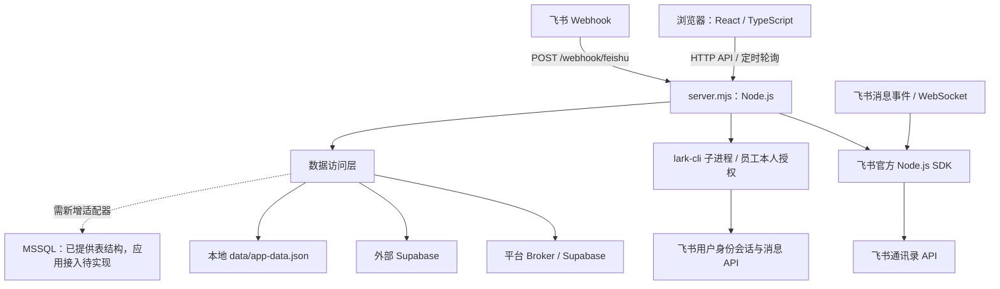

# 飞书通讯录同步与消息订阅管理台

面向飞书企业管理员和开发者的浏览器管理台，用于同步企业通讯录、接收机器人消息事件，以及在员工本人授权后同步其个人私聊记录。

主应用使用 **React + TypeScript 前端、JavaScript + Node.js 服务端**。飞书 API 和事件订阅接入官方 **`@larksuiteoapi/node-sdk`**；个人私聊功能通过 **`@larksuite/cli`** 获取用户授权并读取会话。

> 数据库接入现状：主应用支持平台 Supabase Broker、外部 Supabase 和本地 JSON 文件，**尚未实现 MSSQL 直连**。仓库提供的 [MSSQL 建表脚本](database/mssql/001_create_tables.sql) 可创建与当前业务字段对应的 7 张表；执行脚本后仍需适配服务端数据访问层，才能让应用使用 MSSQL。

## 1. 当前功能

当前前端有 4 个页签：

| 页签 | 主要功能 |
| --- | --- |
| 通讯录同步 | 一键同步部门和人员、统计数量及最近同步时间、关键词搜索、部门筛选 |
| 消息订阅 | 查看 WebSocket 连接状态、浏览机器人消息事件、配置 Webhook 备选通道、手动补拉历史消息 |
| 本人私聊 | 发起员工本人授权、查看授权状态、同步个人单聊会话与消息、退出授权 |
| 设置 | 保存 App ID、App Secret、Encrypt Key、Verification Token，测试应用凭证连通性 |

通讯录同步按 `open_id` 合并跨部门人员。消息订阅页面默认每 5 秒轮询服务端；本人私聊页面每 10 秒刷新。这里的页面实时展示使用 HTTP 轮询，飞书到服务端的实时订阅使用 WebSocket。

本项目没有应用内账号体系。部署在内部环境时，可在平台或反向代理入口增加 SSO 和访问控制。

## 2. 技术栈与目录

| 层次 | 技术 / 语言 | 说明 |
| --- | --- | --- |
| 前端 | React 18、TypeScript / TSX、Vite 7 | 源码位于 `src/`，构建为 `dist/` |
| 主服务端 | JavaScript ES Modules、Node.js 22 及以上 | 所有主应用服务端逻辑集中于 `server.mjs` |
| 飞书 SDK | `@larksuiteoapi/node-sdk` | 声明版本 `^1.76.0`，当前锁定 `1.76.0` |
| 飞书 CLI | `@larksuite/cli` | 声明版本 `^1.0.100`，当前锁定 `1.0.100`，服务端以子进程调用 |
| 数据访问 | `@supabase/supabase-js` 或本地文件适配器 | 仅服务端访问数据库，浏览器不持有数据库密钥 |
| 独立采集器 | Go，`go.mod` 声明 Go 1.21 | `watcher-go/`，独立运行，不是主服务端启动的一部分 |

Node.js 是 JavaScript 的运行环境；`server.mjs` 使用 JavaScript，前端 `.tsx` 文件使用 TypeScript。`watcher-go/` 内的飞书客户端由 Go 标准库 `net/http` 实现，未引入飞书官方 Go SDK。

```text
.
├── server.mjs                    # HTTP API、SDK、订阅、同步、数据访问、静态资源服务
├── src/
│   ├── App.tsx                   # 管理台页面与交互
│   ├── main.tsx                  # React 入口
│   └── styles.css                # 控制台样式
├── package.json                  # 依赖与 npm 命令
├── package-lock.json             # 锁定依赖版本
├── vite.config.ts
├── scripts/prepare-publish.mjs    # 整理 QW Pages 发布目录
├── tests/runtime.test.mjs        # 现有构建与运行时测试
├── database/mssql/
│   └── 001_create_tables.sql      # MSSQL 建表脚本
├── watcher-go/                   # 独立 Go 私聊轮询采集器
├── data/app-data.json            # 本地模式运行后生成，已被 Git 忽略
└── .qw-pages/publish/            # 构建后生成的发布产物
```

## 3. 系统架构



### 3.1 通讯录同步

1. 浏览器调用 `POST /api/sync`。
2. 服务端从 `app_config` 读取凭证，创建或复用 `lark.Client`。Token 获取和复用通过 SDK 与项目缓存实现。
3. 调用 `contact.v3.department.children`，以根部门 `0` 为起点，设置 `fetch_child: true` 并分页拉取部门。
4. 逐部门调用 `contact.v3.user.findByDepartment` 分页拉取人员。
5. 部门按 `department_id` upsert，人员按 `open_id` upsert；跨部门人员合并 `department_ids`。
6. 同步成功后将 `last_sync_at` 写入 `app_config`。

当前同步执行新增或更新，不会删除本次未返回的历史部门或人员。`active` 当前按飞书返回的 `status.is_frozen` 判断，不等同于完整的人事在职状态。

### 3.2 机器人消息订阅

- **默认 WebSocket**：`lark.WSClient` 使用应用凭证建立长连接；保存设置后重建连接，启动时也会尝试连接。
- **备选 Webhook**：`lark.EventDispatcher` 和 `lark.adaptDefault` 处理 `/webhook/feishu`，包含 challenge、解密及验证逻辑；凭证在请求时从存储读取。
- **统一入库**：两种入口共用 `persistMessageEvent()`，写入 `feishu_events`，按 `event_id` 检查重复。
- **历史补拉**：服务端每 60 秒尝试为已知机器人私聊会话补拉消息，写入同一事件表，使用 `poll:<message_id>` 作为补拉记录的事件标识。

MSSQL 脚本对 `event_id` 增加唯一约束。后续接入 MSSQL 时，应将重复键处理为幂等成功，避免并发投递时“先查后插”的竞态产生业务错误。本地文件适配器没有数据库唯一约束，不能据此认定所有存储模式都具备严格并发去重能力。

### 3.3 员工本人私聊

这是与机器人消息分开的采集通道：

1. 服务端调用 `lark-cli config init` 配置应用。
2. 通过 CLI 设备授权流程生成验证链接，由员工本人在浏览器完成授权。
3. CLI 管理用户登录态及 Token；服务端通过 `--as user` 读取个人单聊会话和历史消息。
4. 会话写入 `private_chats`，消息按 `message_id` upsert 到 `private_messages`，流程状态保存在 `private_auth`。
5. 后台每 60 秒尝试同步，会话间隔 250 毫秒。首次消息请求以最近 7 天为起点，之后以最后消息时间向前重叠 2 分钟增量请求。

实际读取范围受用户授权、应用权限、CLI 分页和接口返回限制；当前实现不应被理解为企业所有员工聊天记录的全量归档。主应用只保存一组全局 CLI 授权状态，不是多员工账号管理系统。

### 3.4 独立 Go 采集器

`watcher-go/` 提供另一套可单独部署的个人私聊轮询程序，支持 `auth`、`status`、`serve` 模式，默认 5 秒轮询，包含 OAuth Token 刷新、时间窗口重叠、去重日志和 Token 寿命告警。

它使用自己的环境变量（如 `LARK_APP_ID`、`LARK_APP_SECRET`、`DATA_DIR`、`WATCH_INTERVAL`），将 Token、游标和去重日志写入独立数据目录，消息输出到标准输出或指定文件。**它目前没有接入主应用的 7 张表，也没有自动向管理台导入数据。** 部署示例位于 `watcher-go/deploy/`。

## 4. 数据存储模式

服务启动时按以下顺序选择模式：

| 优先级 | 模式 | 判定和行为 |
| --- | --- | --- |
| 1 | `legacy` | `SUPABASE_URL`、`SUPABASE_ANON_KEY`、`SUPABASE_INSTANCE_ID` 三项均配置；请求携带 `X-Instance-ID` |
| 2 | `broker` | 可连接 `127.0.0.1:9001`，使用平台数据库 Broker |
| 3 | `local` | 以上条件不满足，读写服务目录下的 `data/app-data.json` |

模式在进程启动时确定。外部 Supabase 配置齐全后，即使请求失败，也不会逐请求自动切换到本地文件。只配置部分变量不是有效的外部 Supabase 配置，应完整填写或全部留空。

本地模式适合单实例运行；写入会同步持久化完整 JSON 文件，没有跨进程写锁，不适合多个实例共享同一个文件。需要备份和持久化 `data/`，运行目录必须可写。

`GET /healthz` 和 `GET /api/health` 返回进程健康状态及当前数据库模式，不代表数据库、飞书连接或 CLI 授权均可用。

## 5. 当前需要哪些数据表

**主应用完整功能共需要 7 张表。** 仅启用通讯录和机器人消息时使用前 4 张；员工本人私聊功能还使用后 3 张。当前服务启动会检查私聊状态，完整部署建议一次准备全部表。

| 表名 | 用途 | 业务唯一键 |
| --- | --- | --- |
| `app_config` | 飞书应用配置、最近通讯录同步时间 | `key` |
| `feishu_departments` | 飞书部门 | `department_id` |
| `feishu_users` | 飞书人员及所属部门集合 | `open_id` |
| `feishu_events` | 机器人实时事件及历史补拉记录 | `event_id` |
| `private_auth` | CLI 配置与设备授权流程状态 | `key` |
| `private_chats` | 员工本人单聊会话 | `chat_id` |
| `private_messages` | 员工本人单聊消息 | `message_id` |

本地 JSON 模式使用相同的逻辑表名，不需要执行建表脚本。Supabase 模式需要在相应平台执行兼容其数据库的迁移，不能直接使用本仓库的 T-SQL 脚本。

### 5.1 字段说明与 MSSQL 类型

脚本为每张表提供 `id BIGINT IDENTITY(1,1)` 主键，同时为业务标识建立唯一约束。所有时间字段使用 `DATETIME2(3)`，约定按 UTC 保存；默认时间为 `SYSUTCDATETIME()`。

| 表 | 业务字段 / MSSQL 类型 |
| --- | --- |
| `app_config` | `key NVARCHAR(128)`、`value NVARCHAR(MAX)`、`updated_at DATETIME2(3)` |
| `feishu_departments` | `department_id NVARCHAR(256)`、`name NVARCHAR(500)`、`parent_id NVARCHAR(256)`、`member_count INT`、`synced_at DATETIME2(3)` |
| `feishu_users` | `open_id NVARCHAR(256)`、`user_id NVARCHAR(256)`、`name NVARCHAR(500)`、`email NVARCHAR(512)`、`mobile NVARCHAR(64)`、`avatar NVARCHAR(MAX)`、`job_title NVARCHAR(500)`、`department_ids NVARCHAR(MAX)`、`active BIT`、`synced_at DATETIME2(3)` |
| `feishu_events` | `event_id NVARCHAR(256)`、`event_type NVARCHAR(128)`、`chat_id NVARCHAR(256)`、`chat_type NVARCHAR(32)`、`sender_id NVARCHAR(256)`、`sender_name NVARCHAR(500)`、`message_type NVARCHAR(64)`、`content NVARCHAR(MAX)`、`content_text NVARCHAR(MAX)`、`event_time DATETIME2(3) NULL`、`received_at DATETIME2(3)`、`raw NVARCHAR(MAX)` |
| `private_auth` | `key NVARCHAR(128)`、`value NVARCHAR(MAX)`、`updated_at DATETIME2(3)` |
| `private_chats` | `chat_id NVARCHAR(256)`、`name NVARCHAR(500)`、`peer_id NVARCHAR(256)`、`chat_mode NVARCHAR(32)`、`owner_id NVARCHAR(256)`、`external BIT`、`synced_at DATETIME2(3)` |
| `private_messages` | `message_id NVARCHAR(256)`、`chat_id NVARCHAR(256)`、`sender_id NVARCHAR(256)`、`sender_name NVARCHAR(500)`、`msg_type NVARCHAR(64)`、`content_text NVARCHAR(MAX)`、`create_time DATETIME2(3)`、`ts_ms BIGINT`、`deleted BIT`、`updated BIT`、`thread_id NVARCHAR(256)`、`synced_at DATETIME2(3)`、`raw NVARCHAR(MAX)` |

补充约定：

- `app_config.key` 当前包含 `app_id`、`app_secret`、`encrypt_key`、`verification_token`、`last_sync_at`。`last_sync_at` 的值为 ISO 时间字符串。
- `private_auth.key` 当前包含 `cli_configured`、`cli_authorized`、`device_code`、`verification_url`、`user_code`、`authorized_at`。授权标识使用字符串 `"1"`，不是 SQL `BIT`。
- `department_ids` 在应用中是字符串数组，MSSQL 中保存为 JSON 数组，例如 `["0","1001"]`；`raw` 保存序列化后的 JSON 对象。
- `ts_ms` 为 Unix 毫秒时间戳，使用 `BIGINT`。`create_time` 是该时间的 UTC 日期表示。
- SDK 用户 `open_id`、事件 `sender_id`、CLI 返回的发送者标识不一定属于相同 ID 类型，不能直接据此建立人员外键。
- 为允许乱序入库和同步范围变化，脚本不建立部门、用户、会话之间的强制外键；关系由业务标识关联。
- 业务 ID 和配置键使用二进制排序规则，区分大小写；中文名称、消息正文使用 Unicode 字段。

### 5.2 MSSQL 建表脚本执行方法

文件：[database/mssql/001_create_tables.sql](database/mssql/001_create_tables.sql)。

适用 **SQL Server 2016 及以上**，数据库兼容级别要求 **130 及以上**，使用 `dbo` 架构。

1. 在 SSMS 中连接目标 SQL Server，选择已经创建好的业务数据库。
2. 打开脚本并确认查询窗口的当前数据库。
3. 执行整个脚本，最后会返回 7 张业务表的名称。

脚本不会创建数据库、登录账号或写入任何真实凭证；会拒绝在 `master`、`model`、`msdb`、`tempdb` 执行。账号需要具备目标库建表和创建相关约束、索引的权限。

脚本使用事务，按表是否存在决定是否创建，可重复执行且不删除业务数据。**它不是既有表结构的升级脚本**：同名表已存在时会跳过该表及随表创建的索引，不会自动补列或纠正已有结构。

索引覆盖事件时间线、按会话查消息、按事件类型筛选、按父部门查询等当前访问方式。唯一约束对应代码中的 upsert 冲突键。

### 5.3 应用接入 MSSQL 还需要做什么

当前没有 `mssql` / `tedious` 依赖，也没有 SQL Server 连接参数。不能把 MSSQL 连接串填进 `SUPABASE_URL`，也不能通过执行建表脚本让现有 Supabase 客户端连接 SQL Server。

后续改造需要保持主服务端逻辑位于 `server.mjs`，完成：

1. 增加 MSSQL 驱动、服务端连接池与环境变量配置。
2. 将当前 `.from().select()/upsert()/insert()/eq()/or()/contains()/order()/limit()` 的访问方式转换为参数化 SQL 或等价适配器。
3. 实现按业务唯一键的并发安全 upsert 和事件重复键处理。
4. 写入时序列化 `department_ids`、`raw`，读取时还原为数组和对象；部门筛选可使用 `OPENJSON`。
5. 将 UTC 时间转换为 API 当前使用的 ISO 字符串，并处理 `BIGINT` 在 JavaScript / JSON 中的序列化。
6. 迁移已有 Supabase 或本地 JSON 数据，再验证 API 返回结构和同步流程。

脚本中的 `updated_at`、`synced_at` 默认值只在插入且未提供值时生效；更新时仍由应用显式赋值，不使用自动更新时间触发器。

## 6. 本地启动与发布

### 6.1 启动主应用

要求 Node.js 22 及以上和 npm。安装依赖时，CLI 的安装脚本可能需要联网下载平台二进制。

在 PowerShell 中：

```powershell
npm ci
npm run build
$env:HOST = "127.0.0.1"
$env:PORT = "8080"
npm start
```

然后访问 `http://127.0.0.1:8080`。没有平台 Broker 且未配置外部 Supabase 时，自动使用本地文件存储。

`HOST`、`PORT` 是服务端必填环境变量，缺失会启动失败。`npm start` 不会自动加载 `.env`；可以提前设置环境变量，或使用 Node.js 的 `--env-file` 参数显式加载自己的配置文件。

| 环境变量 | 主应用用途 |
| --- | --- |
| `HOST` | 必填，HTTP 监听地址；容器中通常为 `0.0.0.0` |
| `PORT` | 必填，HTTP 端口，范围 1–65535 |
| `SUPABASE_URL` | 外部 Supabase / 兼容网关 URL |
| `SUPABASE_ANON_KEY` | 外部数据库访问密钥，仅服务端使用 |
| `SUPABASE_INSTANCE_ID` | 外部数据库实例 ID，与前两项一起配置 |
| `LARK_CLI_BIN` | 可选，指定存在的 CLI 可执行文件路径 |
| `NODE_ENV` | 运行环境标记，生产通常使用 `production` |

应用凭证通过设置页录入，不通过 `LARK_APP_ID` / `LARK_APP_SECRET` 配置主应用；这两个变量属于独立 Go 采集器。

### 6.2 开发与检查

```powershell
npm run dev
npm run typecheck
npm test
```

`npm run dev` 只启动 Vite 前端开发服务，当前 Vite 配置没有 `/api` 代理。需要完整联调时可先构建后运行 `npm start`，或自行配置 Vite 代理并同时启动 Node 服务端。

`npm test` 会重新构建并执行现有运行时测试，部分测试会安装发布产物的生产依赖，需要网络。现有测试仍包含健康接口返回值仅为 `{ "status": "ok" }` 的旧断言，而当前实现还返回 `database` 字段；运行这些测试前需要留意该差异。

### 6.3 QW Pages 发布

`npm run build` 先生成 `dist/`，再由 `scripts/prepare-publish.mjs` 整理 `.qw-pages/publish/`。当前主应用发布目录顶层应包含：

```text
dist/
package.json
package-lock.json
server.mjs
```

发布目录无需包含 README、MSSQL 脚本或独立 Go 采集器。平台 Supabase 表应通过平台迁移流程准备，应用启动不会执行数据库 DDL。

## 7. 飞书应用配置

1. 准备企业自建应用，在设置页保存 App ID 和 App Secret。
2. 开通通讯录相关权限和所需数据可见范围，发布应用版本；代码提示包含 `contact:department.base:readonly`、`contact:user.base:readonly`。
3. 点击“测试连通性”。此操作只验证获取 `tenant_access_token`，不代表通讯录和消息权限已经齐全。
4. 在飞书应用中配置 `im.message.receive_v1` 事件，使用长连接接收模式，并检查页面的连接状态。
5. 若使用 Webhook，配置公网可达的 `/webhook/feishu` 地址，并在设置页填写对应 Encrypt Key、Verification Token。
6. 若使用本人私聊，在对应页签发起授权并完成浏览器确认。

本人私聊当前向 CLI 请求以下用户权限，最终是否可用取决于应用已开通并发布的权限及员工实际授权结果：

```text
im:chat:read
im:message:readonly
im:message.p2p_msg:get_as_user
im:message.group_msg:get_as_user
contact:user.base:readonly
```

设置页读取接口返回脱敏后的凭证状态；保存时空字段表示保持原值，不用于清空配置。数据库和本地 JSON 文件中的配置没有额外的应用层加密。CLI 初始化还会将配置交给 CLI 自身管理，部署时也需要持久化、保护其配置和登录态目录。

## 8. HTTP 接口

| 方法 | 路径 | 用途 |
| --- | --- | --- |
| GET | `/healthz`、`/api/health` | 进程健康和当前数据库模式 |
| GET / POST | `/api/config` | 读取脱敏配置 / 保存配置并重建订阅 |
| POST | `/api/config/test` | 应用凭证连通性测试 |
| POST | `/api/sync` | 同步通讯录 |
| GET | `/api/departments` | 部门列表 |
| GET | `/api/users?search=&department=` | 人员搜索、部门筛选，最多返回 500 条 |
| GET | `/api/stats` | 部门、人员和机器人事件数量 |
| GET | `/api/subscription` | WebSocket 状态及机器人历史补拉状态 |
| GET | `/api/events?event_type=&limit=` | 机器人事件，默认 50 条，最多 200 条 |
| POST | `/api/poll` | 手动补拉机器人已知私聊的历史消息 |
| POST | `/webhook/feishu` | 飞书事件回调 |
| GET | `/api/private/status` | CLI 可用性、授权及同步状态 |
| POST | `/api/private/auth/start` | 发起本人授权 |
| POST | `/api/private/auth/complete` | 完成本人授权 |
| POST | `/api/private/auth/logout` | 退出本人授权 |
| POST | `/api/private/sync` | 手动同步本人私聊 |
| GET | `/api/private/chats` | 本人会话列表和消息统计 |
| GET | `/api/private/messages?chat_id=&limit=` | 本人消息，默认 100 条，最多 500 条 |

## 9. 当前边界

- 原始 `AGENTS.md` 介绍的是 3 个页签和 4 张表；本文按当前源码补充了本人私聊页签、3 张私聊表以及本地文件存储。
- 企业通讯录能同步的范围由飞书应用权限决定；同步过程没有清理历史缺失数据的步骤。
- 机器人历史补拉只针对已知会话，且存在列表和消息数量限制，不能保证无遗漏地恢复任意时间范围的历史。
- 本人会话列表、会话统计和消息读取也存在代码中的数量上限；首次 7 天窗口不代表自动翻完全部历史页。
- 主应用、本地存储和 CLI 授权状态目前面向单实例、单套应用配置使用。生产扩容、多用户隔离和 MSSQL 接入需要后续实现。

## 10. 建表脚本验证

本脚本已在隔离的 SQL Server 2019（`15.0.4500.2`）临时实例中实际执行，验证内容包括：

- 首次创建全部 7 张表、重复执行，以及重复执行后已有数据保留。
- 数据库兼容级别为 130 时执行成功。
- 7 张表的样例写入、中文内容、JSON 部门数组查询与原始事件 JSON 读取。
- 7 个业务唯一键拒绝重复值，业务 ID 区分大小写。
- 非法 JSON、非数组的 `department_ids`、负数人数和负数消息时间戳被约束拒绝。
- 默认时间和布尔字段正常生成，Unix 毫秒时间戳以 `BIGINT` 保存。
- 系统数据库执行保护。

此验证覆盖 MSSQL 表结构，不代表现有应用已完成 MSSQL 连接或端到端联调。SQL Server 2016 引擎本身未单独实测。

## 11. 官方参考

- [飞书 Node.js SDK 源码与用法](https://github.com/larksuite/node-sdk)
- [SQL Server JSON 支持与兼容级别](https://learn.microsoft.com/en-us/sql/relational-databases/json/json-data-sql-server)
- [SQL Server OPENJSON](https://learn.microsoft.com/en-us/sql/t-sql/functions/openjson-transact-sql)
- [SQL Server SYSUTCDATETIME](https://learn.microsoft.com/en-us/sql/t-sql/functions/sysutcdatetime-transact-sql)
